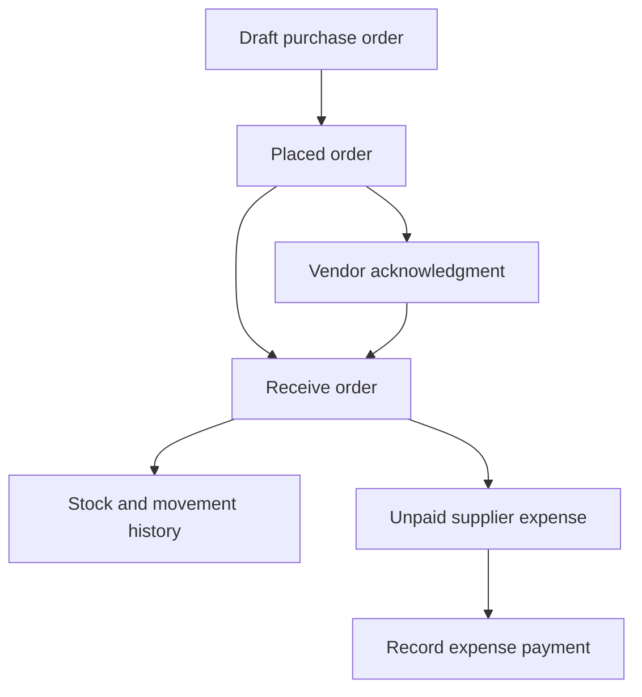
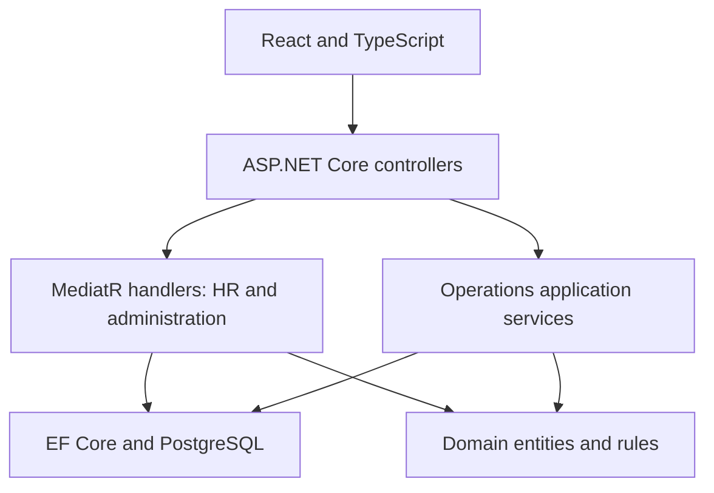

# BizCore — Business Management Platform

[](https://github.com/Vishaljadaun/BizCore/actions/workflows/ci.yml)

**A deployed, multi-tenant ERP portfolio project built with ASP.NET Core, React, and PostgreSQL.**

BizCore brings employee administration, attendance, leave, project delivery, purchasing, inventory, supplier collaboration, and basic finance into one company workspace. Its core workflows persist in PostgreSQL and connect across modules: receiving a purchase order updates stock and creates its supplier expense in one transaction.

**Project status:** the current portfolio milestone is complete. Core workflows are implemented, tested, and deployed; future extensions are documented below. This is a learning ERP with working business rules, not a production-certified payroll or accounting system.

**[Open live app](https://bizcore-web.onrender.com/#/login)** · **[API health](https://bizcore-api-e7is.onrender.com/health)** · **[Test results](https://github.com/Vishaljadaun/BizCore/actions)** · **[Guided demo](docs/OPERATIONS.md)**

## Contents

- [The problem it addresses](#the-problem-it-addresses)
- [Try the live app](#try-the-live-app)
- [Features and modules](#features-and-modules)
- [Roles and access](#roles-and-access)
- [Connected business workflows](#connected-business-workflows)
- [Technology stack](#technology-stack)
- [Architecture and request flow](#architecture-and-request-flow)
- [Data model and persistence](#data-model-and-persistence)
- [Authentication and account security](#authentication-and-account-security)
- [Repository guide](#repository-guide)
- [Local setup](#local-setup)
- [Configuration](#configuration)
- [API overview](#api-overview)
- [Testing and verification](#testing-and-verification)
- [Deployment and operations](#deployment-and-operations)
- [Troubleshooting](#troubleshooting)
- [Known limits and future extensions](#known-limits-and-future-extensions)
- [What this project demonstrates](#what-this-project-demonstrates)
- [Detailed documentation](#detailed-documentation)

## The problem it addresses

Small teams often track staff, tasks, stock, and payments in separate spreadsheets. That makes it easy to approve more leave than someone has available, record a delivery twice, lose track of a supplier expense, or give someone access to another company's records.

BizCore models a shared workspace for those activities. A small agency can assign work and record customer payments; an office team can purchase supplies and track stock; a manager can review attendance and leave; a supplier can acknowledge only the orders shared with its account. These are demonstration scenarios for learning how connected business applications behave.

## Try the live app

1. Open **[BizCore](https://bizcore-web.onrender.com/#/login)** and choose **Register your company**. Use fictional company and staff information.
2. Register your own CompanyAdmin account. There is no shared default administrator password.
3. Create a department and employee, then grant/link the employee's login access.
4. Use a separate browser profile or private window for the employee or vendor account. Normal tabs share browser login storage.
5. Follow the [employee and leave guide](docs/TESTING.md), [administration guide](docs/ADMINISTRATION.md), or [10-minute operations demo](docs/OPERATIONS.md).

The frontend and API run on Render; the database runs on Neon. The free API may take around a minute to wake after inactivity. Wait for the first request to finish before submitting again. Business records are stored outside the API container, so restarting the API with the same database does not require registering again.

## Features and modules

| Module | Implemented capabilities |
| --- | --- |
| Company and account administration | Company registration; login; company-code disambiguation; platform company administration; user creation, editing, role/status management; protected administrator accounts. |
| Departments and employees | Create departments; edit names, descriptions and managers; create/view/edit employees; link or revoke login access; deactivate/reactivate while retaining history. |
| Employee self-service | Personal profile, linked HR records, clock-in/out, leave balances, application history and pending-request cancellation. |
| Attendance | Company list, employee/date filters, pagination, clock actions, worked-time display and CSV export of matching records. |
| Leave management | Annual policies, whole-weekday applications, overlap checks, pending balance reservations, approval/rejection and recorded reviewer identity. |
| Dashboard | API-backed company or personal metrics, role-appropriate shortcuts, loading states, error messages and retries. |
| Projects | Project lifecycle, tasks, assignment, priorities, due dates, task status and personal time logs. |
| Inventory | Product/SKU catalog, stock adjustments with reasons, movement history, low-stock filtering and purchase orders. |
| Vendors | Supplier directory, vendor account linking, contract lifecycle and a vendor portal for shared records and order acknowledgment. |
| Finance | Draft/issued invoices, partial/full payment records, manual and purchase-linked expenses, cash-flow reporting and CSV export in INR. |
| Account security | Own-password change, administrator-assisted reset, mandatory temporary-password replacement and session revocation. |

Operations screens share form validation, searchable relationship selectors, pagination, status badges, dialogs and responsive record cards. Frontend navigation reflects permissions; the API independently enforces access rules.

## Roles and access

| Role | Main responsibilities and boundaries |
| --- | --- |
| SuperAdmin | Platform company administration and privileged account administration; business-module actions use the current company context. |
| CompanyAdmin | Company users, departments/employees, HR review, projects, inventory, suppliers and finance. Cannot assign CompanyAdmin or modify another CompanyAdmin through ordinary user management. |
| Manager | Company HR visibility/review, projects/tasks, time logs, stock, suppliers and orders. No finance access or department/employee editing. |
| Employee | Own linked HR profile, attendance and leave; assigned tasks and own time entries. |
| Vendor | Linked supplier profile, shared contracts/orders, order acknowledgment and own account security. No staff or finance modules. |

A user account and an employee record are separate. Unlinking removes HR self-service access but leaves the login active. Employee deactivation also disables the linked login and revokes its sessions; reactivating the employee does not automatically reactivate that login.

Managers can see salary fields under the current simple HR policy. Granular salary permissions remain future work. Exact restrictions, including self-modification and last-administrator protection, are in [ADMINISTRATION.md](docs/ADMINISTRATION.md).

## Connected business workflows

### Employee onboarding and leave

Create a department and employee, grant login access, and let the employee clock in/out from **My Profile**. An administrator creates an annual leave policy; the employee submits dates and a reason. Pending requests reserve allowance, approval spends the reserved days, and rejection or pending cancellation releases them. A reviewer cannot approve their own request.

Leave applications and decisions use per-employee PostgreSQL transaction locks so simultaneous requests cannot reserve the same remaining allowance or approve the same request twice.

### Purchasing, inventory and supplier expense

Create a supplier and optionally link a Vendor account. Add products, draft a purchase order, and place it. The vendor can acknowledge the placed order. Receiving the order updates stock, records movements, and creates one unpaid supplier expense for a nonzero purchase total.



The receipt's stock and expense writes commit together. Repeating a receipt is rejected. Voiding an expense does not reverse physical stock; purchase returns are a future feature.

### Projects and customer payments

An administrator or manager creates a project, assigns tasks, and tracks progress. Employees update their assigned tasks and log their own time. Every task must be done before its project can be completed; reopen a project before adding more work.

Finance can independently issue a customer invoice and record payments received outside BizCore. An invoice moves through **Draft → Issued → PartPaid → Paid**. Payment retries with the same request ID do not create duplicate records, and payments cannot exceed the outstanding balance. The cash-flow report compares receipts with paid expenses. Project billing is not automatically linked to invoices in this version.

## Technology stack

Versions below describe the current repository; exact dependency versions live in the project files and npm lockfile.

| Area | Technology | Why it is used |
| --- | --- | --- |
| API runtime | C# / .NET 8 / ASP.NET Core | Typed REST endpoints, middleware, dependency injection and role authorization. |
| Application workflows | MediatR 12, FluentValidation 11 | Commands/queries and validation for administration and HR; operations use dedicated application services. |
| Persistence | Entity Framework Core 8, Npgsql, PostgreSQL 16 | Entity mapping, migrations, relational constraints and transaction-backed writes. |
| Authentication | JWT bearer tokens, rotating refresh tokens, BCrypt.Net-Next | Signed access tokens, renewable sessions and password hashing. |
| Frontend | React 19, TypeScript 6, Vite 8 | Component-based screens, typed API models and production builds. |
| UI | Tailwind CSS 3, Lucide React | Shared styling and interface icons. |
| Routing and state | React Router 7, Zustand 5 | Protected routes and a single session store. |
| HTTP and forms | Axios, React Hook Form, Zod 4 | API calls, coordinated token refresh, forms and client validation. |
| API exploration | Swagger / OpenAPI | Interactive endpoint documentation in Development. |
| Automated checks | xUnit, EF InMemory, Vitest, React Testing Library, ESLint, Playwright | Fast regression tests plus real browser/API workflows against PostgreSQL. |
| Delivery | GitHub Actions, Docker, Render, Neon | Repeatable builds/tests, containerized API, static frontend and persistent hosted database. |

## Architecture and request flow

BizCore is a modular monolith: one API deployment and one relational database, organized into domain, application, infrastructure and API projects. HR and administration use MediatR handlers; Projects, Inventory and Finance use a shared operations service split by workflow. The frontend is deployed separately.



A protected request follows these steps:

1. Axios sends the access token to the API. Concurrent expired-token requests share one refresh attempt; a late refresh cannot restore a session after logout.
2. JWT authentication validates the token. Current-account middleware checks the database account/company, credential version and current role before authorization.
3. Controllers dispatch to application handlers/services. Validation and ownership checks apply before state changes.
4. Infrastructure supplies EF Core persistence and token services. Critical workflows use PostgreSQL transactions and advisory locks.
5. The API returns results or meaningful error responses; the UI updates its state or offers an error/retry path.

Domain entities represent business records. The Application project defines workflows and persistence/service interfaces. Infrastructure implements those interfaces and database mappings. The API composes the application and exposes HTTP routes. The Domain project does not depend on the web UI or API.

## Data model and persistence

A single PostgreSQL database contains three application schemas. Company identifiers, tenant-aware filtering, explicit ownership checks and operations foreign-key constraints establish company boundaries; this is not a separate database per tenant.

| Schema | Records | Main relationships |
| --- | --- | --- |
| `shared` | Companies, users, refresh tokens, audit logs | Company → users; user → sessions; actor/target references for audit events. |
| `hr` | Departments, employees, attendance, leave types, balances, requests | Company → departments/employees; employee → attendance and leave; optional employee-to-user link. |
| `ops` | Projects, tasks, time entries, suppliers, contracts, products, orders/lines, movements, invoices/lines/payments, expenses | Project → tasks → time; supplier → orders/contracts; receipt → stock/expense; invoice → payments. |

The API applies existing EF migrations at startup. Later migrations add leave reviewer fields, operations tables and account-security fields without resetting existing accounts or business records. Keep the database connection and JWT signing key stable across deployments.

Important consistency choices:

- Composite company/record foreign keys keep linked operations records within a company.
- Unique indexes protect SKUs, document numbers, supplier portal links, receipt expenses and payment/stock-adjustment request IDs.
- Check constraints reject invalid quantities, stock and amounts.
- Company-scoped operations locks serialize related writes; employee-scoped leave locks protect balances. Account/employee administration also coordinates locks for credential changes, linking and last-admin checks.
- Payment and adjustment request IDs make retries idempotent: the same request returns the original result; reusing its ID with different data returns a conflict.

Company-wide operations locking is a deliberate low-volume design. Higher throughput would require finer-grained locking and load testing. The current account lookup adds a database read to authenticated requests; an already executing request can finish during an access change.

## Authentication and account security

- Company registration creates a CompanyAdmin. Login uses email/password and optionally a company code when the email belongs to more than one company.
- Passwords are BCrypt hashes. Access tokens default to 15 minutes; refresh tokens last 7 days and rotate when used.
- Middleware refreshes role/profile claims from current database values, so an old Manager token cannot preserve manager access after demotion.
- Changing a password requires the current password, increments the credential version, revokes sessions and requires signing in again.
- Administrator-assisted reset requires the administrator's own password. The temporary-password user must choose a replacement before using business modules. No reset email is sent.
- Password change/reset requires at least 12 characters with uppercase, lowercase, a digit and a symbol, and at most 72 UTF-8 bytes. Registration and account-creation validators have their own rules; follow the relevant form feedback.
- Ordinary user endpoints cannot assign SuperAdmin, modify another SuperAdmin, disable/delete yourself, change your own role or remove the last active CompanyAdmin. Assigning CompanyAdmin or modifying another CompanyAdmin requires SuperAdmin.
- Password and employee changes record audit events without plaintext passwords. A complete audit-history interface is not included.

Tokens currently live in browser storage. HttpOnly cookie sessions, MFA, email verification, public emailed recovery and rate limiting remain production-hardening work. See [the security guide](docs/ADMINISTRATION.md) for recovery boundaries and current tradeoffs.

## Repository guide

| Path | Responsibility |
| --- | --- |
| `backend/BizCore.Domain/` | Entities, enums and domain events. |
| `backend/BizCore.Application/` | Commands, queries, validation, security rules and operations services. |
| `backend/BizCore.Infrastructure/` | EF mappings, migrations, PostgreSQL access, token service and optional seeding. |
| `backend/BizCore.API/` | Controllers, middleware, configuration and application startup. |
| `backend/BizCore.Tests/` | Backend regression tests. |
| `frontend/bizcore-web/src/` | React modules, shared components, API clients, routes, types and session store. |
| `frontend/bizcore-web/e2e/` | Browser/API workflow and persistence scenarios. |
| `.github/workflows/` | Build/test CI and on-demand hosted deployment checks. |
| `scripts/` | Live smoke checks, persistence checkpoints and isolated CI recovery rehearsal. |
| `docs/` | Detailed testing, administration, operations, deployment and scope guides. |
| `backend/Dockerfile` | API build and non-root runtime image. |
| `compose.e2e.yml` | Disposable local PostgreSQL test service. |
| `render.yaml` | Deployment template documenting the frontend/API setup. |

## Local setup

Prerequisites: .NET 8 SDK, Node.js 22.12+ with npm, and a PostgreSQL database you can migrate. The API applies its existing EF migrations at startup. Use a development database, not a database belonging to another app.

### Backend

Clone the repository first:

```bash
git clone https://github.com/Vishaljadaun/BizCore.git
cd BizCore
```

From the repository root:

```bash
cd backend/BizCore.API

dotnet user-secrets set "ConnectionStrings:DefaultConnection" "Host=localhost;Port=5432;Database=bizcore;Username=YOUR_ROLE;Password=YOUR_PASSWORD"
dotnet user-secrets set "JwtSettings:SecretKey" "YOUR_PRIVATE_RANDOM_SECRET_AT_LEAST_32_CHARACTERS"

dotnet run --launch-profile http
```

Replace the placeholders. For hosted PostgreSQL, use the provider's host and TLS configuration in .NET/Npgsql key/value format. Keep credentials in user secrets or private host environment variables.

- API: `http://localhost:5001/api`
- Swagger in Development: `http://localhost:5001/swagger`
- Optional HTTPS launch profile: `https://localhost:7205`; trust the development certificate first and adjust the frontend URL accordingly.

### Frontend

Open a second terminal at the repository root:

```bash
cd frontend/bizcore-web
npm ci
npm run dev
```

Open `http://localhost:5173`. The committed development configuration points to port 5001. Use `.env.development.local` to override `VITE_API_BASE_URL`, with `.env.example` as a reference. Restart Vite after changes.

Use **Register** to create your first company and CompanyAdmin account. A seeded super-admin is not required for the company workflow.

### Optional platform administrator

There is no automatically created shared-password account. For a fresh local database, explicitly opt into seeding:

```bash
# Run from backend/BizCore.API; replace these sample values.
dotnet user-secrets set "Seed:Enabled" "true"
dotnet user-secrets set "Seed:SuperAdminEmail" "YOUR_ADMIN_EMAIL"
dotnet user-secrets set "Seed:SuperAdminPassword" "YOUR_PRIVATE_PASSWORD_AT_LEAST_12_CHARACTERS"
```

Start the API once, then disable `Seed:Enabled`. The seeder does not reset an existing administrator or print the password. Existing databases created with the old default login retain that account: change its credentials through a controlled administrative process before exposing that database publicly. Use **Account Security → Change password** while signed in.

## Configuration

| Backend environment variable | Purpose |
| --- | --- |
| `ConnectionStrings__DefaultConnection` | Private PostgreSQL/Npgsql connection string. |
| `JwtSettings__SecretKey` | Private signing key of at least 32 characters. |
| `JwtSettings__Issuer` / `JwtSettings__Audience` | Must match token generation and validation; defaults are in appsettings. |
| `JwtSettings__AccessTokenExpiryMinutes` | Access-token duration; default 15 minutes. |
| `Cors__AllowedOrigins__0` | Exact hosted frontend origin; add subsequent indices for more origins. |
| `ASPNETCORE_ENVIRONMENT` | `Development` locally; `Production` on the host. |
| `Seed__Enabled` | Optional privileged-account bootstrap; disabled by default. |
| `Seed__SuperAdminEmail` / `Seed__SuperAdminPassword` | Credentials used only when explicitly bootstrapping. |

| Frontend environment variable | Purpose |
| --- | --- |
| `VITE_API_BASE_URL` | API base including `/api`; local default `http://localhost:5001/api`. |
| `VITE_USE_HASH_ROUTER` | `true` on the hosted static site; local development uses browser routes by default. |
| `VITE_API_TIMEOUT_MS` | Request timeout; local default 30,000 ms, hosted configuration 120,000 ms for cold starts. |

Refresh-token expiry is currently fixed at seven days in the application handlers; the similarly named appsettings value is not wired into those handlers.

`VITE_API_BASE_URL` is a public frontend value. Database credentials and signing keys must never be frontend environment variables.

Local development permits Vite origins on ports 5173–5175. Hosted CORS origins come from `Cors__AllowedOrigins__0` (and subsequent indices). The deployment uses Docker, a separate static frontend and Neon; see [DEPLOYMENT.md](docs/DEPLOYMENT.md).

## API overview

The API exposes REST controllers under `/api`. Use **[local Swagger](http://localhost:5001/swagger)** in Development for exact request/response schemas; Swagger is disabled in Production.

| Endpoint group | Purpose |
| --- | --- |
| `/api/auth` | Register, login, refresh, logout, current account and password change. |
| `/api/companies` | Platform company administration. |
| `/api/users` | Users, role/status changes and administrator-assisted password reset. |
| `/api/hr/departments` | Department lists, creation and editing. |
| `/api/hr/employees` | Employee records, current profile, account links, status, attendance and personal leave. |
| `/api/hr/leave` | Leave policies, request lists and approval/rejection/cancellation. |
| `/api/hr/overview` | Company or personal dashboard metrics. |
| `/api/hr/attendance/export` | Filtered attendance CSV. |
| `/api/operations` | Projects, tasks, time entries, suppliers, contracts, products, orders, stock, invoices, payments, expenses and reports. |
| `/health` | Anonymous startup/process health check. |

Business routes require bearer authentication and enforce their role/ownership checks. Typical failures distinguish invalid input (400), invalid/missing authentication (401), insufficient access (403), missing/foreign records (404) and conflicting state (409). A temporary-password account receives `password_change_required` for business endpoints until its password is changed.

See [the operations API map](docs/OPERATIONS.md#api-map) for route suffixes, lifecycle actions, query parameters and retry behavior.

## Testing and verification

### Fast checks

From the repository root:

```bash
dotnet restore backend/BizCore.sln
dotnet build backend/BizCore.sln --configuration Release --no-restore
dotnet test backend/BizCore.sln --configuration Release --no-build

cd frontend/bizcore-web
npm ci
npm run lint
npm test
npm run build
```

### Browser tests with real PostgreSQL

Install Docker with Compose and the SDK/Node prerequisites above. Stop other API/frontend processes on ports 5001 and 5173. From the repository root:

```bash
docker compose -f compose.e2e.yml up -d --wait
dotnet build backend/BizCore.sln --configuration Release
cd frontend/bizcore-web
npm ci
npx playwright install chromium
npm run test:e2e
npx playwright show-report
```

Playwright starts the API and frontend itself. On Linux, use `npx playwright install --with-deps chromium` when browser libraries are missing. These tests target only the disposable `bizcore_e2e` database at localhost port 55432. Its committed credentials and JWT key are test-only; do not use them for a deployment.

### What is verified

| Layer | Coverage |
| --- | --- |
| Backend | Employee ownership, tenant filters, account status/link revocation, JWT subjects, token refresh, leave rules, administration restrictions and operations invariants. Fast handler tests use EF InMemory; those alone do not prove PostgreSQL behavior. |
| Frontend | Coordinated refresh, logout races, failed refresh, route access, employee profile/attendance errors, preserved failed leave forms and dashboard retry states. |
| Browser and API | Employee/leave, connected operations, administration/security and persistence scenarios using Chromium and PostgreSQL 16; includes selected phone-sized screens. |
| Concurrency | Competing leave applications/approvals, repeated receipts and payments, and account/session changes against the real database. |
| Restart | CI restarts the API against the same database, signs in with the original credentials and compares original record IDs. |
| Recovery | CI dumps its populated disposable database, restores into a separate database and compares row counts and hashes of all row values across application tables. |
| Hosted smoke checks | Fictional company workflows, frontend/API/CORS, roles, persistence and connected business operations. |

At the **15 October 2026 portfolio milestone**, verification passed with **33 backend tests, 16 frontend tests and four browser/API scenarios run twice**. The isolated restore rehearsal matched all **24 application tables**. The [merged milestone CI run](https://github.com/Vishaljadaun/BizCore/actions/runs/38776934678) is a dated reference, not a claim about every future commit.

GitHub Actions runs backend, frontend and browser jobs on `main`, `codex/**` pushes and pull requests. Reports are attached to the browser job. The restore check does not configure scheduled production backups or establish provider backup retention. Targeted mobile tests do not replace full accessibility, device, load or security audits.

See [TESTING.md](docs/TESTING.md) for complete commands, cleanup, expected results and private persistence-checkpoint handling. Live checks create clearly named fictional records in the hosted database; ordinary CI uses an isolated database.

## Deployment and operations

| Component | Current portfolio deployment |
| --- | --- |
| Frontend | Render static site, built with `npm ci && npm run build` in `frontend/bizcore-web`; publishes `frontend/bizcore-web/dist`. |
| Backend | Render Docker web service built from `backend/Dockerfile` with `backend` as context. |
| Database | Separate Neon PostgreSQL 16 database; API and database are configured in Singapore. |
| Routing | Hosted HashRouter links such as `/#/login` survive static-site refresh without rewrite rules. |
| Transport | Render provides public HTTPS; the API container accepts internal HTTP on the host's `PORT`. |

The API runs migrations before it starts accepting requests. `GET /health` reports successful process startup; it is not an ongoing database availability probe. Business data lives in PostgreSQL, not the container filesystem. Keep the signing key and connection settings unchanged for routine deployments.

Both services track `main`. Auto-deploy has not triggered reliably in previous updates: check the deployed commit after a merge and, if needed, use **Manual Deploy → Deploy latest commit**. For frontend environment changes, rebuild the static site because Vite embeds its public settings at build time.

`render.yaml` documents how to recreate the setup; applying it over the existing services may create duplicates. See [DEPLOYMENT.md](docs/DEPLOYMENT.md) for exact environment settings and update procedures. Production backup scheduling, retention monitoring and an operator-owned recovery plan remain future operations work.

## Troubleshooting

| Symptom | Check |
| --- | --- |
| First hosted login takes a while | Allow the idle API to wake; wait for the in-flight request before retrying. |
| API fails on startup | Read the first startup error; check database reachability/migration permissions and the private JWT key. |
| Frontend cannot reach API | Verify `VITE_API_BASE_URL` includes `/api`, API availability and the exact CORS origin. Restart/rebuild the frontend after configuration changes. |
| Local Swagger is missing | Run the Development launch profile on port 5001. Production intentionally disables Swagger. |
| Employee has no profile | Create/link the HR employee record from the administrator account; a login alone is not an employee profile. |
| Login needs a company code | The email is used in multiple companies. Supply the intended company's code, available on Account Security while signed in. |
| User cannot enter business modules after reset | Sign in with the temporary password and complete Account Security's mandatory password change. |
| Reactivated employee still cannot sign in | Activate the linked account separately in User Management. |
| Records seem missing after a restart | Confirm the same database and company are selected. Refreshing or restarting normally retains records; do not create replacement accounts as a workaround. |
| Hosted site still looks old after a merge | Compare the frontend/API deployed commits with `main`; manually deploy if no automatic build started. |
| Browser test times out | Check API startup/migration logs, local ports and the Playwright report; a page timeout may originate in backend startup. |

## Known limits and future extensions

The current milestone is suitable for demonstrating end-to-end application engineering. The following work is intentionally left for later:

| Area | Current boundary | Possible extension |
| --- | --- | --- |
| Attendance | UTC calendar days and a fixed 09:30 UTC lateness threshold; no payroll integration. | Company timezones, shifts, overnight attendance, correction approval and payroll rules. |
| Leave | Whole Monday–Friday days; holidays count; requests start today or later in UTC and stay within one current/next calendar year. No carryover, proration, half-days, policy editing or approved-request cancellation. | Holiday calendars and configurable company policies. |
| Projects | Tasks and personal time tracking; no automatic project billing or budgets. | Budgets, milestones and time-to-invoice workflows. |
| Inventory | Whole stock units, one stock pool, full-order receipt only. | Partial delivery, returns and multiple warehouses. |
| Finance | INR, manually recorded payments and cash flow; no real payment processing, statutory invoicing, journals, refunds or credit notes. | Accounting integration, payment gateway and jurisdiction-specific tax workflows. |
| Account recovery | Administrator-assisted reset; a sole locked-out administrator needs operator assistance. | Verified email recovery and MFA. |
| Permissions and sessions | Simple roles, manager salary visibility and tokens in browser storage. | Granular permissions, hardened browser sessions and rate limiting. |
| Audit | Selected mutation events, without a complete history UI or immutable compliance log. | Searchable audit screens and stronger audit retention. |
| Operations | Free hosting cold starts; test-only restore rehearsal; no scheduled production backups or comprehensive load/security audit. | Monitoring, backup schedule, recovery drills and measured scaling. |

Attendance and cash-flow CSV exports cap at 10,000 rows and neutralize spreadsheet formula prefixes. Date-range reports support up to 366 days. Net cash flow means receipts minus paid expenses, not accounting profit. Full business limits and state transitions are documented in [OPERATIONS.md](docs/OPERATIONS.md).

A focused future product experiment could add overdue-invoice reminders and stock alerts with notifications, then validate them with a small team. These are roadmap ideas; the current low-stock UI already works, but automated notification delivery is not included. No additional module is required to present this milestone as a portfolio project.

## What this project demonstrates

- Building connected workflows across HR, projects, stock, purchasing and finance.
- Structuring an ASP.NET Core modular monolith with application boundaries and dependency injection.
- Designing a multi-tenant relational model and enforcing roles/record ownership on the server.
- Handling stale authorization claims, refresh races, password resets and session revocation.
- Protecting balances, stock and money records with transactions, constraints and idempotent retries.
- Implementing typed React forms, responsive workflows and useful error states.
- Testing beyond unit tests with real PostgreSQL, browsers, concurrent requests, restart checks and restore rehearsal.
- Shipping a separate frontend/API/database deployment and documenting its operational limits.

Built by **[Vishal Jadaun](https://github.com/Vishaljadaun)** for learning and portfolio demonstration. To review the project, start with the live demo, follow a connected workflow, then inspect its application service and corresponding tests. Future work can extend this documented baseline without presenting unfinished features as complete.

## Detailed documentation

| Guide | Read it for |
| --- | --- |
| [Testing](docs/TESTING.md) | Local/browser setup, manual checklists, CI reports, restart and recovery checks. |
| [Administration](docs/ADMINISTRATION.md) | Employee/account actions, permission boundaries, recovery and security design. |
| [Operations](docs/OPERATIONS.md) | Full demo, role matrix, business rules, data model and operations API map. |
| [Deployment](docs/DEPLOYMENT.md) | Hosting, secrets, public build settings, CORS and updating the deployed app. |
| [Milestones and remaining scope](docs/COMPLETION.md) | Implemented milestones and deliberate future extensions. |
